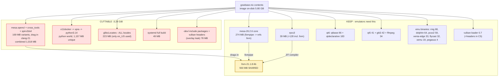
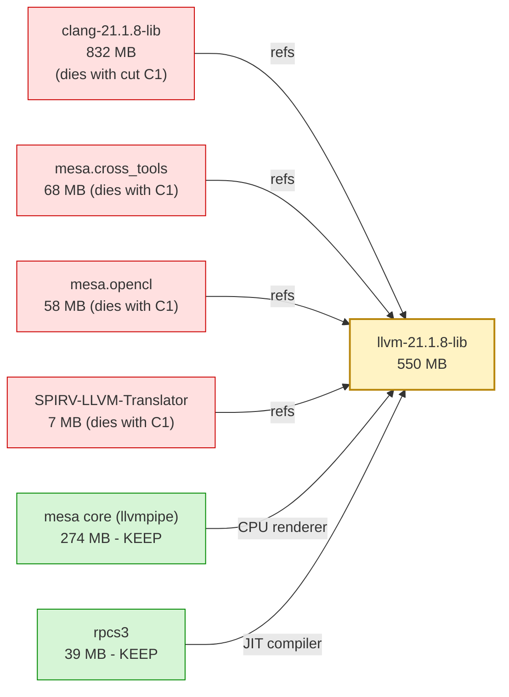
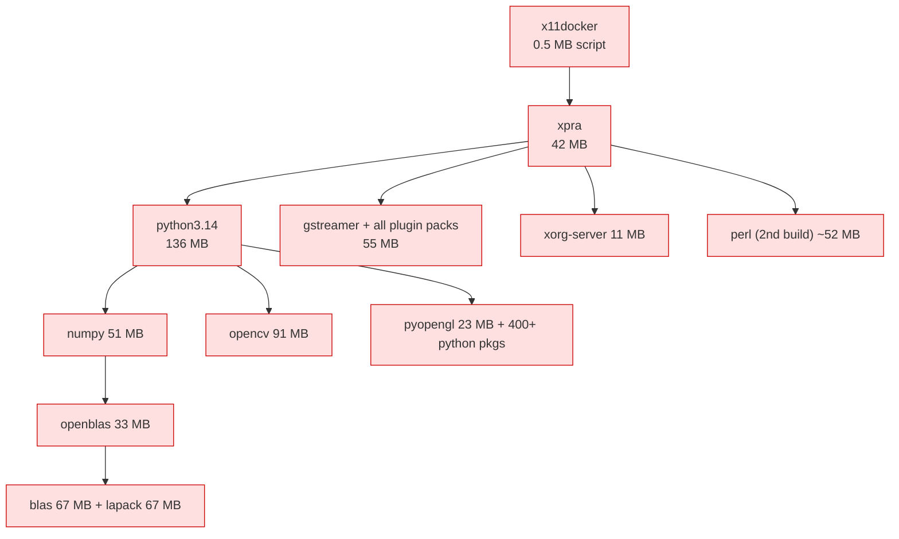
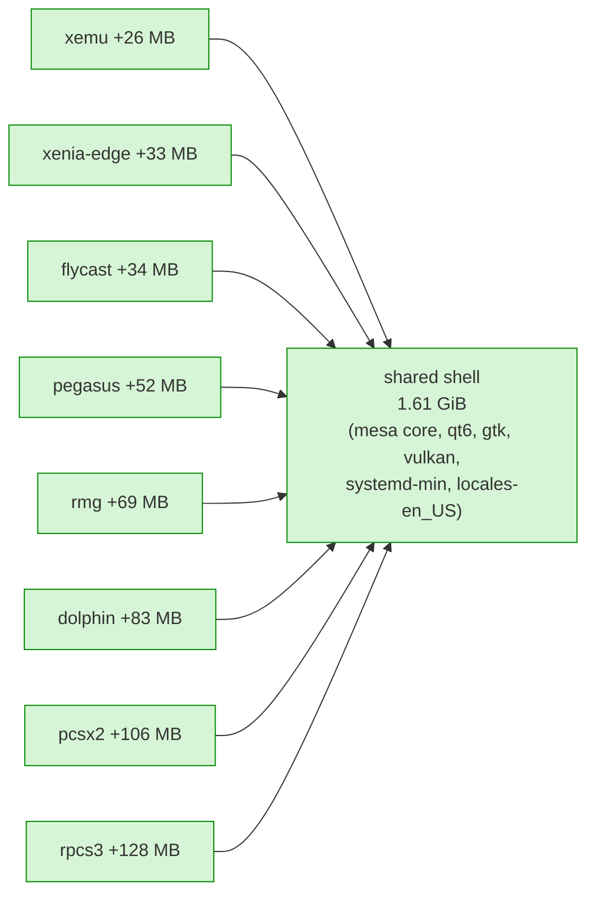

# `hello-docker:latest` — dependency graph

Generated from the real image: 1,018 Nix store paths, 6,082 measured references
(`nix path-info` + ELF dynamic-linker scan + script/config dumps).
Sizes are MB on-disk (`du` inside the image). **Arrow A → B = "A references B"** (links against, shebang, or config reference).

**Legend:** 🔴 red = cuttable with zero feature loss · 🟢 green = keep (emulators need it) · 🟡 yellow = shared bottleneck.

---

## 1. The whole image, cut view

Cutting the red block: **5.80 GB → ~2.26 GiB** (all-in-one, every emulator kept).

---

## 2. The 550 MB LLVM fan-in (who actually needs it)

This is the whole story in one picture. Today, **six** things reference
`llvm-21.1.8-lib`. After the cuts in section 1, only **two** remain:

To delete the 550 MB entirely you must remove **both** green arrows:
mesa built without `llvmpipe` **and** rpcs3 built without dynamic LLVM
(its own PPU compiler only). That's the "GPU-only" scenario - your box
always has the real RX 7800 XT, so nothing inside the image needs
CPU software rendering or a runtime LLVM JIT.

---

## 3. Inside the 1,157 MB: what the x11docker cut actually removes

`x11docker` is a 0.5 MB script. Its value is what it drags in:

Nothing in `opt/gow/*` launches xpra or x11docker - it's X11-forwarding
tooling. The python/blas/opencv stack exists only to serve xpra.

---

## 4. Per-emulator images, after the cuts

One shared shell, one image per emulator. Identical layers are byte-identical
content-addressed Nix paths → the registry stores the shell **once**,
each emulator image costs only its `+N MB` delta.

| image | size | vs pegasus:fedora (1.18 GiB) |
|---|---|---|
| any of the 8 emulator images | 1.64 – 1.74 GiB | +0.5 – 0.55 GiB |
| …plus GPU-only scenario (drop llvmpipe + LLVM JIT) | **1.10 – 1.20 GiB** | ≈ **matches** |

---

## The numbers behind the diagrams

| cut | unique bytes removed | why it's safe |
|---|---|---|
| C1 mesa variants + clang chain | 1,018 MB | plain `mesa` already in image; variants are build/dev tooling |
| C2 x11docker → xpra → python world | 1,157 MB | not launched by anything in `opt/gow` |
| C3 glibcLocates → en_US only | ~205 MB | image runs with `LANG=en_US.UTF-8` |
| C4 systemd full → minimal | 49 MB | systemd-min already present via other packages |
| C5 -dev headers + vulkan-headers | 78 MB | headers only; runtime never reads them |
| **total** | **~3.28 GiB** | **floor: 5.80 GB → 2.26 GiB** |

*Full graph (all 1,018 nodes / 6,082 edges): `image-graph-full.dot` - render with
[Graphviz Online](https://dreampuf.github.io/GraphvizOnline/) or `dot -Tsvg`.*
